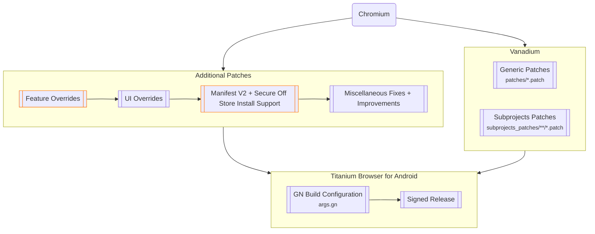

# Titanium Browser for Android

[](https://github.com/D3SOX/android-titanium-browser/actions/workflows/build.yml)
[](https://github.com/D3SOX/android-titanium-browser/releases)
[](https://github.com/D3SOX/android-titanium-browser/blob/main/LICENSE)

This is a personal fork of [Titanium Browser for Android](https://github.com/jqssun/android-titanium-browser) by [jqssun](https://github.com/jqssun). Titanium is a secure, fully open-source, Chromium-based web browser with support for extensions, based on [Vanadium](https://github.com/GrapheneOS/Vanadium) by [GrapheneOS](https://github.com/GrapheneOS). Advanced features live in the separate [**Titanium Extension for Android**](https://github.com/jqssun/android-titanium-extension).

For the latest build, see [**Releases**](https://github.com/D3SOX/android-titanium-browser/releases/latest). Each release has one APK for arm64 devices. To get updates, [add Titanium to Obtainium](https://apps.obtainium.imranr.dev/redirect?r=obtainium://app/%7B%22id%22%3A%22io.github.jqssun.helium%22%2C%22url%22%3A%22https%3A%2F%2Fgithub.com%2FD3SOX%2Fandroid-titanium-browser%22%2C%22author%22%3A%22D3SOX%22%2C%22name%22%3A%22Titanium%22%2C%22preferredApkIndex%22%3A0%2C%22additionalSettings%22%3A%22%7B%5C%22apkFilterRegEx%5C%22%3A%5C%22arm64-v8a%5C%5C%5C%5C.apk%24%5C%22%2C%5C%22versionDetection%5C%22%3Afalse%7D%22%7D), which also sets up the arm64 APK filter.

[](https://github.com/D3SOX/android-titanium-browser/releases/latest)
[](https://apps.obtainium.imranr.dev/redirect?r=obtainium://app/%7B%22id%22%3A%22io.github.jqssun.helium%22%2C%22url%22%3A%22https%3A%2F%2Fgithub.com%2FD3SOX%2Fandroid-titanium-browser%22%2C%22author%22%3A%22D3SOX%22%2C%22name%22%3A%22Titanium%22%2C%22preferredApkIndex%22%3A0%2C%22additionalSettings%22%3A%22%7B%5C%22apkFilterRegEx%5C%22%3A%5C%22arm64-v8a%5C%5C%5C%5C.apk%24%5C%22%2C%5C%22versionDetection%5C%22%3Afalse%7D%22%7D)

This fork signs its releases with its own key and keeps the package name `io.github.jqssun.helium`. An installed upstream build can't be updated with it. Uninstall the upstream build first, which deletes its data.


## Changes from upstream

- The new tab button in the tab switcher sits on the right, next to the menu button ([jqssun/android-titanium-browser#300](https://github.com/jqssun/android-titanium-browser/issues/300)).

  

- Settings open each page in its own activity, as in older Chromium versions. Going back returns to the previous page at the same scroll position, and pages no longer jump when the settings search bar hides.

  | Upstream | This fork |
  | --- | --- |
  |  |  |

- **Apply dark theme to sites, when possible** under **Settings** > **Appearance** > **Theme** is available and on by default.
- The build adds a missing dependency on the generated omnibox `vector_icons.h` header, which otherwise fails to compile at random.
- Releases contain only the arm64 APK. There is no armeabi-v7a APK and no App Bundle.
- Every two days, GitHub Actions merges upstream and updates Vanadium to its latest tag, and builds a release if that changed anything. It also builds on every push to `main`. Each release gets its own tag so that Obtainium sees every build as an update.
- A full build takes longer than the 6-hour limit of a GitHub-hosted runner, so it runs in chained stages that pass the build output to the next stage. The build uses ninja instead of siso and leaves out debug symbols (`symbol_level = 0`) to fit the runners' disk and memory.

## Usage

### Installing extensions

You can install extensions from the following sources:
- [Chrome Web Store (Recommended)](https://chromewebstore.google.com/)
- [Opera Add-ons](https://addons.opera.com/)
- [Microsoft Edge Add-ons](https://microsoftedge.microsoft.com/addons/)

You can also install from a local CRX (or ZIP) file in the options page of the built-in [**Titanium Extension for Android**](https://github.com/jqssun/android-titanium-extension).

To test an unpacked extension, open [`chrome://extensions`](chrome://extensions), turn on **Developer mode**, select **Load unpacked**, and choose the folder that contains the extension in the Storage Access Framework (SAF) picker. The extension may take a moment to load.

### Using extensions

To run an extension in Incognito (OTR) mode, go to **Manage extensions**, find the extension, select **Details**, and turn on **Allow in Incognito**.

The built-in [**Titanium Extension for Android**](https://github.com/jqssun/android-titanium-extension) adds an external download manager, enhanced dark mode, and more privacy options.

### Debug URLs

To view and access the debug URLs, use [`chrome://chrome-urls`](chrome://chrome-urls). For **Experiments**, use [`chrome://flags`](chrome://flags).

### WebRTC IP policy

Open the menu <kbd>⋮</kbd> in the top right corner, then select **Settings** > **Privacy and security**. Titanium shields IPs from WebRTC by default. If a WebRTC service such as [Discord Voice](https://discord.com/blog/how-discord-handles-two-and-half-million-concurrent-voice-users-using-webrtc) doesn't work, change the policy to **Default public interface only** or **Default**.

## Implementation

> [!WARNING]
> Titanium only tries to improve security and privacy where possible. For better protection on Android, use [GrapheneOS](https://grapheneos.org) with [Vanadium](https://vanadium.app). Vanadium also patches the Android System WebView, and GrapheneOS hardens the kernel and memory management at the OS level.



## Verifying releases

[GitHub Actions](https://github.com/D3SOX/android-titanium-browser/actions) builds every release and attests its build provenance. Check an APK with the [GitHub CLI](https://github.com/cli/cli):

```shell
gh attestation verify *.apk -R D3SOX/android-titanium-browser
```

## Credits

Titanium is the work of [jqssun](https://github.com/jqssun), and builds on [Vanadium](https://github.com/GrapheneOS/Vanadium) and the privacy-focused, open-source approach of other Chromium projects. All credit goes to the original authors and contributors. Titanium started around the same time as [Helium Browser for Linux](https://github.com/imputnet/helium-linux) but isn't affiliated with the desktop Helium project.
